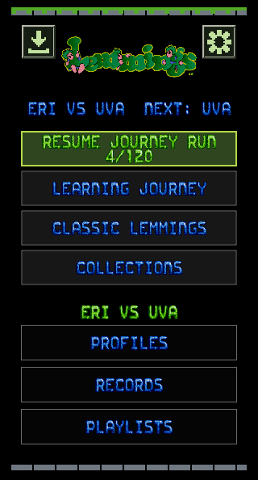
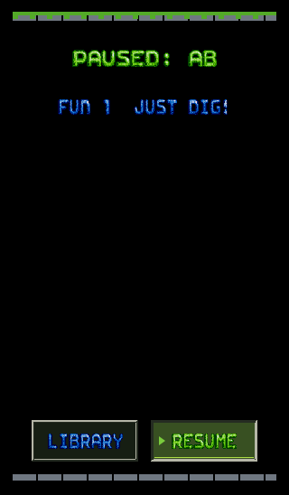

# iOS Hot Seat identity and saved-run recall

13 October 2026. This extends the [gameplay HUD evidence](../2.0HotSeatHUD-2026-10-13/README.md).

The HUD label was covered by opaque pause, hint, settings and result pages.
Those pages now use the same frozen attempt owner. Pause names the player in
its heading. Results say who played, and the Retry/Next controls name their
recipient. Ready retains the player's name as its heading and stays paused.
Library and level-selection pages identify the waiting player. Home also shows
the full session name above the Resume controls.

The home Resume action now reads the same saved journey or progression run
that it opens. It keeps the saved name and position, and either participant can
recall a shared journey. Selecting a saved Hot Seat reloads its host's collections.
Solo and shared playlist queues retain separate saved order, position and seed.
Resume restores a matching checkpoint and its attempt owner. A checkpoint from
another session cannot be applied by the journey or playlist Resume action.
A failed turn save prevents checkpoint handover. Skip passes the turn before
advancing. The shared collection import preserves archived runs and their L2
progress metadata when another session saves.

## Validation

- **95 renders and target checks pass:** 19 states at five iPhone/iPad sizes.
  All targets are at least 44 points, do not intersect, and route to their own
  action. Identity sheets for all five sizes were inspected, along with complete
  narrow Ready, pause, result and saved-run pages.
- **37 muted background tests pass:** Hot Seat rules, scoped checkpoint storage,
  saved journey and progression recall, guest recall, separate solo/shared
  playlist queues, shuffle seed and position, prepared checkpoint restoration,
  portrait HUD and adaptive layout.
- **Unsigned arm64 iOS Debug compilation passes.** An initial build overlapped
  an unrelated simulation edit; the completed source was rebuilt successfully.
- Mac Classic, L2 and L3 retain their existing attempt ownership and paused Ready
  handovers. The iOS canvas/controller changes are shared, but the shipped iOS
  library still does not expose playable L2/L3 campaigns. No native sequel
  gameplay parity or physical UIKit/VoiceOver validation is claimed here.

[Machine-readable results and source hashes](validation.json) accompany the
[capture inventory](captures.json). The inventory includes all 95 windowless
renders in `.build/hot-seat-flow`; this directory retains representative images.

Reproduce the bitmap audit with the built `LemmingsMobileMenuAudit` executable,
artwork directory, Classic data directory, output directory and `--hot-seat-flow`.
Set `LEMMINGS_TEST_AUDIO=muted` and `LEMMINGS_TEST_WINDOWS=offscreen`.
