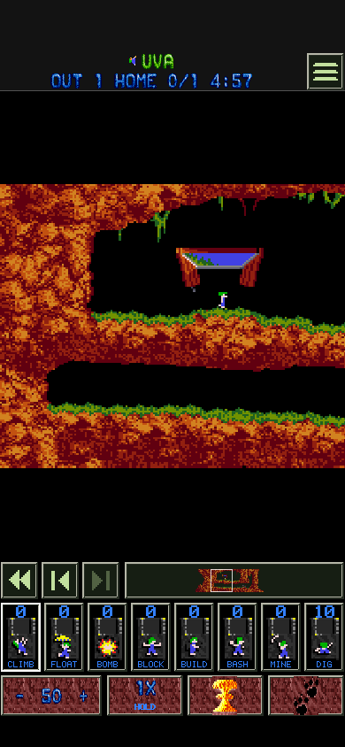

# Player icon and name during iOS play

14 October 2026. The gameplay HUD shows the attempt owner's chosen profile
portrait beside their name. It reuses the shipped sprites, green bitmap lettering
and existing 20-point identity row above the counters. It adds no input target
and covers no terrain. VoiceOver says “Current turn” with the full player name.
Ready and selection pages keep their distinct next-player wording. Pause and
results retain the named states verified in the
[flow evidence](../2.0HotSeatFlow-2026-10-13/README.md).

All **80 windowless, muted render and input-target checks pass**, covering all
eight portrait choices, solo and paused states, and portrait, landscape, narrow,
compact, iPad, divided and occluded layouts. The audit checks that the icon and
name fit, stay clear of gameplay, counters and controls, and that every control
remains reachable. The status montage and representative full screens were
inspected. The unsigned arm64 iOS Debug build also passes.

The renderer is shared across iOS session adapters. Playable L2/L3 campaigns
remain unavailable in the iOS library. Physical UIKit and VoiceOver checks
still require device testing. This evidence describes source validation,
not installation on the user's device.

[All status states](status-overview.png), [capture inventory](captures.json),
and [validation and source hashes](validation.json).
