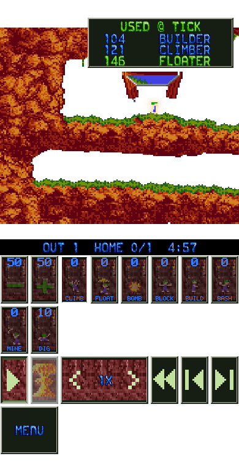
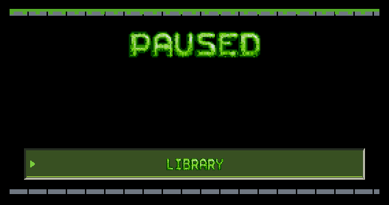
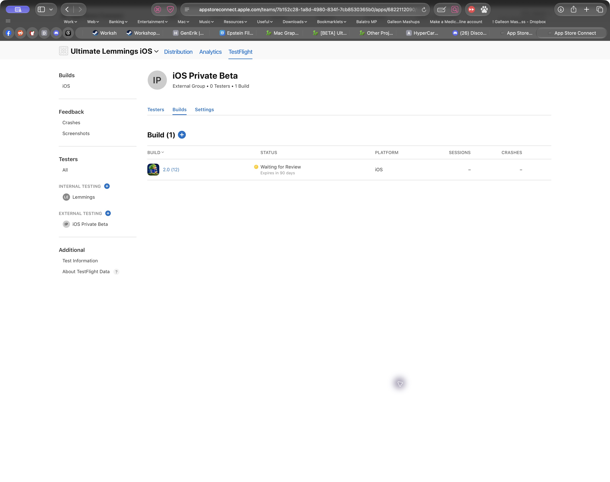

# iOS current Mac fixes and Apple preparation — 13 October 2026

The Classic iOS source follows published macOS 1.9.4, build 79, at commit
`bdb7ba5b`. This extends the [12 October parity evidence](../2.0IOSParity-2026-10-12/README.md).
Lemmings 2 and Lemmings 3 mobile campaigns and renderers remain owner-deferred.
Physical-device acceptance and Apple-side Game Center activation remain pending.

## Current fixes

- Command+Z steps back. Plain Z, Shift+Z and system command chords keep their existing behaviour.
- Rescue auras reuse the calmer Mac sprite masks. The scenery haze uses the shared bounded asynchronous cache.
- Read-only replays show the last three successful skill uses and exact ticks. Current and legacy scheduled replay inputs are supported.
- Seeking backward rebuilds replay history. Rejected assignments do not appear. Review leaves the original replay unchanged.
- Journey lookup finds the active Hot Seat, solo run or an earlier hosted Hot Seat. It preserves queue position, progress, roster and turn.
- The latest shared learning version 18, progression version 4 and 295 lessons are bundled.
- Show Song Info and full-rescue music behaviour already use shared logic. Sparkle and the fading floating Mac Menu button remain Mac features.

## Focused verification

All native checks ran through `Tools/UITestRunner/run.py` with its default
offscreen mode and muted audio. No test window, simulator or app launch occurred.
No full release audit or universal Mac build was run.

| Check | Result |
| --- | --- |
| Shared regressions | 40 passed: 22 engine/learning, 13 MobileCore and 5 AppCore; [log](shared-regressions.log) |
| Final bounded replay history | 7 passed after the last source change; [log](replay-final.log) |
| iOS build and Game Center tooling | 22 passed; [log](apple-tooling-tests.log) |
| Focused replay/rescue bitmap checks | Six geometries rendered and inspected; [record](render-checks.json) |
| Input targets | At least 44 points, no HUD overlaps, no replay-panel overlap with controls |
| Cramped landscape layouts | Existing Paused fallback retained. The replay panel stays hidden behind that overlay |

The rescue render uses a forced full-effect fixture to inspect the sprite mask.
It is not evidence of a completed gameplay rescue. Shared rescue-state tests
verify the rescue threshold and full-population behaviour. Device EDR, UIKit
event delivery, VoiceOver and physical controller behaviour remain device checks.

## Apple preparation

[The iOS Game Center manifest](../../GameCenterIOSSetup.json) specifies the
separate iOS bundle `academy.glasscode.lemmings.ios`, 359 boards, exact score rules
and four sets. Its verification status is pending. No Apple configuration changed.
The Safari App Store Connect session stopped at sign-in. No API credentials were
available for an authenticated configuration check.

The build checks signature and profile Game Center entitlements and bundle/team
identity. Runtime Game Center remains unavailable until the complete iOS Apple
configuration is recorded and checked. See [activation procedure](../../GameCenterSetup.md#ios-20-preparation).
The historical macOS activation record covers a different app and fewer boards.
It is not evidence for this iOS catalogue.

Builds 10 and 11 are superseded because source changed while their candidates
were being prepared. Do not upload them. 
## Final signed candidate

Version 2.0 build 12 exported with Xcode 27.1 for App Store Connect. Its 8,323
source and artwork hashes stayed unchanged and still matched the workspace at
final verification. The device executable and crash-symbol UUIDs match. The
signature and distribution provisioning profile authorise Game Center for the
correct iOS bundle and team. Development debugging is disabled. The distribution
profile has no registered-device restriction and is not an all-devices profile.

The IPA is `.build/ios-beta/2.0-12-macos-1.9.4/Export/UltimateLemmingsIOS.ipa`.
Its SHA-256 is `7d97c984d1cf0d6ab087404e97b869bd751c761daa74da8d43bc6d1f5474e72d`.
The archive is in the same candidate directory. The candidate was not uploaded,
installed or launched. Game Center runtime availability remains off because the
iOS Apple configuration has not been verified.

Records: [signed export](signed-export.json),
[distribution verification](distribution-verification.json),
[source hashes](source-manifest.json), [content validation](content-validation.json)
and [App Store preparation](app-store-readiness.json).

## TestFlight delivery

The owner requested tester delivery and a shareable TestFlight link. The Apple
account was signed in. The existing `Ultimate Lemmings` record uses
`academy.glasscode.lemmings`, so it cannot accept the retained iOS bundle.
A matching record, `Ultimate Lemmings iOS`, was created with Apple ID
`6822112090`, bundle `academy.glasscode.lemmings.ios` and SKU
`ultimate-lemmings-ios`. Management access was limited to the owner and Apple's
mandatory existing account-wide roles. The iOS version was set to 2.0 and
public App Store release remains manual.

Build 12 uploaded successfully on 13 October. Xcode confirmed that the package
was processing with Apple. The first packaging attempt stopped before upload
because Homebrew rsync received Apple's unsupported extended-attributes flag.
The retry used Apple's system PATH and succeeded. See
[upload record](testflight-delivery.json) and [sanitised upload log](testflight-upload.log).
The original export records retain their status at export time.

Public tester delivery is not yet enabled. After automatic approval review
blocked internal group creation and saving the review contact, the owner created
the internal group `Lemmings` and saved Test Information. The group is attached
to build 12. Apple requires an internal group before an external group. See [Apple's external testing procedure](https://developer.apple.com/help/app-store-connect/test-a-beta-version/invite-external-testers/).

The [prepared beta metadata](testflight-metadata.json) names the playable scope
and asks testers to check input, saves, Hot Seat, replay, audio and layout.
It does not claim Game Center availability or L2/L3 mobile campaigns.

Apple marked the upload Complete. Build-specific What to Test instructions
were saved and verified. The owner created the internal group `Lemmings`, which
is attached to build 12, and saved Test Information with the review contact.

The owner clarified that this is private beta testing and saved the License
Agreement as “Not for distribution. Private testing only.” The owner's
description, review notes and license text were retained. Apple's external
TestFlight category covers testers outside the App Store Connect team; it does
not submit the app for public App Store release.

The external group `iOS Private Beta` was created with ID
`7cc0d55f-1757-4799-ba5a-4757a1267ad0`. Build `2.0 (12)` was added and submitted
for Beta App Review. Apple now shows **Waiting for Review**. Automatic tester
notification is enabled. There are no testers in this group yet. The Apple
build ID is `1d4a15a0-f76b-4125-8e89-556d2d8caa4e`.

The owner created and approved the shareable invitation link after automatic
approval review requested explicit permission for access through forwarded links.
The link was verified in App Store Connect and returned only to the owner. It is
omitted from repository evidence because it is intended for private tester
sharing. The ignored local delivery record retains the URL.

App Store Connect states that testers cannot join through the link until this
group has an approved build. Joining and installation remain pending Beta App
Review. No public App Store release has been submitted.

