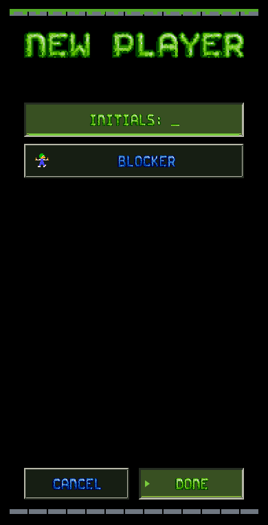
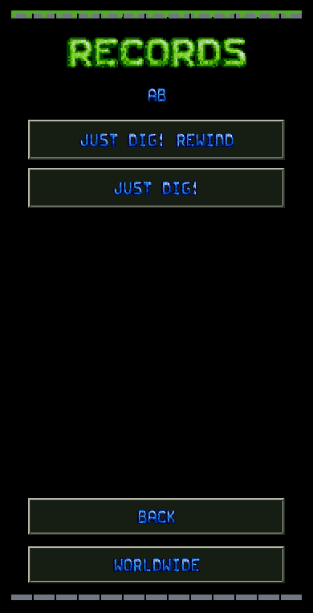
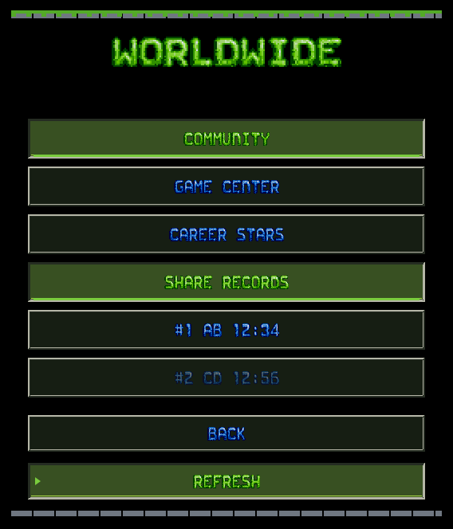
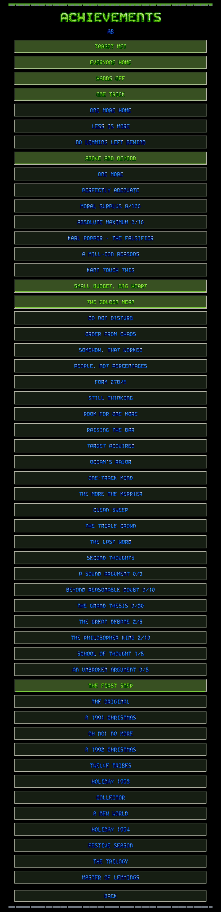
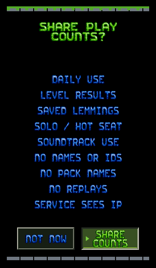
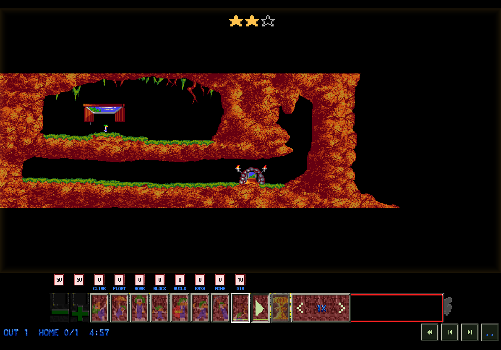
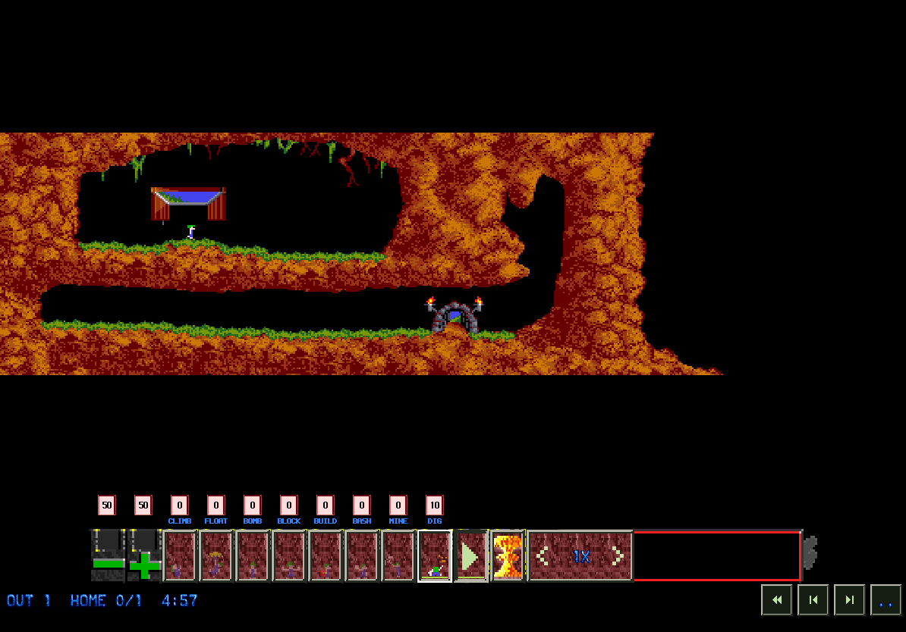

# Classic iOS port evidence — 12 October 2026

This evidence covers the Classic scope in the
[iPad feature parity plan](../../IPadFeatureParityPlan.md). It covers source,
shared logic, bitmap rendering and an unsigned iOS build. It does not establish
physical-device acceptance or three-engine parity.

## Implemented scope

The [current parity matrix](../../IOSInterfaceParity.md#current-classic-port-source)
lists the settings, profiles, records, collections, rewind, replay, teaching,
Hot Seat, online adapters, input, presentation, audio and information pages.
The Mac and iOS reuse the shared stores, rules and bitmap artwork. Saves retain
their profile or Hot Seat owner. Failed saves block result continuation and
turn changes.

Lemmings 2 and Lemmings 3 mobile libraries, campaigns and renderers remain
owner-deferred. NeoLemmix is a separate engine decision. Collection entries
retain mobile IDs and `mobile-v1` revisions; direct reopening through the Mac
catalogue is not guaranteed. Curated teaching and ranked replays use canonical
source identities.

## Automated verification

All native checks use `Tools/UITestRunner/run.py` in its default offscreen mode,
with `LEMMINGS_TEST_AUDIO=muted`. Bitmap captures create images directly without
opening a window. No test changed system volume or saved audio settings.

| Check | Result and evidence |
| --- | --- |
| Shared regression suites | 178 tests passed: 94 NxlvKit, 68 MobileCore and 16 AppCore; [log](shared-regressions.log) |
| Full fan corpus | All 6,020 levels loaded, rendered and ticked; zero failures and zero empty packs; [log](fan-corpus.log) |
| Profile identity, collection migration, checkpoint ownership, online score rules and result awards | 9 tests in 5 suites passed; [verification](career-verification.json) |
| Settings migration, journey music, progression analysis and fan-count cache | 8 tests passed; [log](lemmings-ios-settings-tests.log) |
| Rewind and replay | 5 tests passed, including old checkpoint restoration, saved history, future truncation, read-only replay and assisted undo-nuke; [log](mobile-rewind-test.log) |
| Native artwork and start countdown | 2 tests passed; exact authored Mac/Amiga pixels, unchanged simulation state and paused/hidden countdown; [log](mobile-artwork-test.log) |
| iOS build tooling | 19 tests passed; [log](lemmings-parity-tooling-tests.log) |
| Offline nuke audio | Passed bass/treble, speed/pause/rewind, saved countdown, spatial effects, mute and result recovery checks; [log](lemmings-ios-nuke-audio-tests.log) |
| Controller input | Bindings, menu chords, RT tap/hold/rapid exit and interrupted input passed; [log](controller-input.log) |
| Mac integration | 63 checks passed, including 294 journey lessons, audio/input, records, rewind, saved runs and Classic/L2/L3 Ready boundaries; one foreground-only focus check skipped; [log](mac-integration.log), [record](mac-integration.json) |
| Final bitmap pages and input geometry | 264 pages, 40 HUD states, 6 native artwork states, 84 settings-size captures, 6 covers and 3 unfolding frames; [report](final-ui-audit.json), [log](final-ui-audit.log) |
| Career geometry | 2,178 targets and 108 career captures within the 264-page audit; [report](career-audit.json) |

The final render review found and fixed clipped narrow-phone consent text and
a hidden level-access value. The fresh audit verifies the corrected pages and
targets. The Macintosh and Amiga running, paused and read-only review states
were inspected for authored pixels, counters, enabled controls and result stars.

The Mac harness used complete local content and recording fixtures with current
parity metadata. Its retry test now waits for asynchronous solution metadata.
Its settings test reveals scroll targets and checks the shipped section heading
before testing input. These corrections retain the result and hit-target checks;
they do not change the Mac product interface.

## Unsigned iOS archive

Build 9, version 2.0, passed the Release archive checks with Xcode 27.1. The tool
verified packaged content, the executable and matching arm64 symbol UUIDs. The
source manifest remained unchanged during the build. The candidate is at
`.build/ios-beta/2.0-9-parity-final-current/UltimateLemmingsIOS.xcarchive`.

Records: [archive verification](unsigned-archive.json),
[source hashes](source-manifest.json), [content validation](content-validation.json)
and [build log](unsigned-archive.log). It is unsigned and was not exported,
installed or uploaded. The tooling's `launchScope` lists the broader release
goal; the verified playable scope of this candidate is Classic.

## Render inspection

Rendered pages and their targets were checked at six phone/iPad geometries,
including narrow portrait and landscape layouts. These representative captures
show the shipped bitmap artwork:

## Owner acceptance still required

UIKit event delivery and VoiceOver, physical keyboard/controller/pointer,
composited CRT/EDR and Duo displays, live Game Center sign-in, downloads, sharing
and audible playback require an installed candidate. The owner must configure
the iOS app record and production Game Center service in App Store Connect.
No accounts, leaderboards, device installations, uploads or foreground tests
were performed for this evidence.

The Mac integration runner explicitly skips controls-help focus checks in
offscreen mode. That check requires a new owner-authorized foreground run;
no foreground fallback was attempted.

Downloads retain their foreground lifecycle. The compact touch deck retains
its grouped controls; a dedicated one-thumb edge layout remains an adaptive
UI follow-up.
