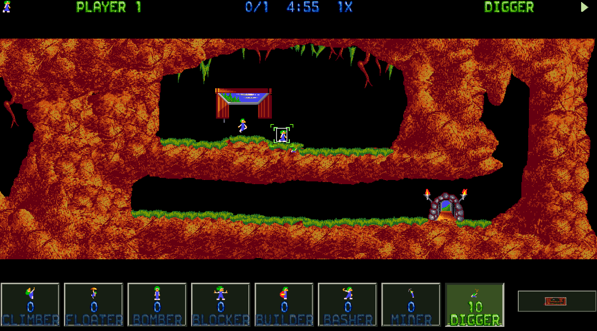
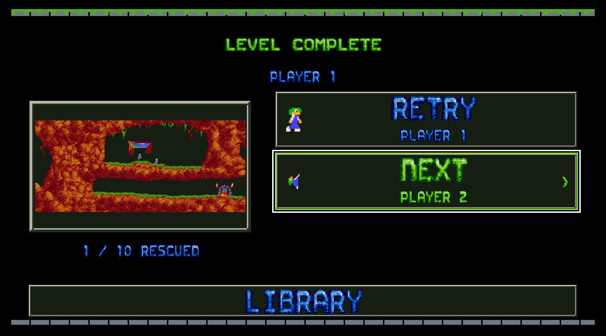

# Apple TV development validation — 14 October 2026

The native Classic TV development flow builds for arm64 tvOS Simulator.
These checks cover shared gameplay state, shipping bitmap renderers and input
target geometry. They do not establish physical Apple TV acceptance.

## Completed checks

| Check | Result |
| --- | --- |
| `Scripts/check-tv-experience.sh` | 94 checks passed across Classic and native Lemmings 2 and 3 fixture sessions |
| Menu renderer and target audit | 76 captures passed: 19 states, two whole pixel scales and two text sizes |
| Native Macintosh playfield audit | Six captures passed with native render scale 2 |
| Final Xcode Debug build | Passed, unsigned arm64 tvOS Simulator, minimum tvOS 16, SDK 27.2 |
| App Info, privacy manifest and Xcode project | `plutil -lint` passed |
| Whitespace validation | `git diff --check` passed |

The native test runner used offscreen mode and muted test audio. No Simulator
window or physical device was launched. The app product is
`.build/tv-xcode/Build/Products/Debug-appletvsimulator/UltimateLemmingsTV.app`.

Gameplay checks cover Ready, the fresh countdown, restored Resume, native
assignment, actor-ID locking, planning, lifecycle recovery, checkpoint
ownership and retirement, Hot Seat handovers and controller input priming.
Lemmings 2 and 3 use native runtime fixtures. Their complete campaigns and
TV renderers remain unavailable.

The audit uses the same bitmap renderers as the app. Menu data is a set of
explicit state fixtures. Geometry checks cover minimum target sizes, board
bounds and non-overlapping focus outlines. They do not dispatch UIKit focus
events. See [the capture manifest](captures.json) for every state and scale.

## Reviewed captures

The final visual review covered the large home page, partial success,
countdown, active playfield and unavailable assignment state. Earlier reviews
also covered briefing, handover, levels, pause, settings and success.

## Remaining release gates

Physical Siri Remote and controller input, focus events, VoiceOver, the
system keyboard, sofa readability, signed installation, 1080p and 4K timing,
memory and thermal behaviour still require validation. Runtime audio was
not tested. The virtual iPhone TV Remote needs separate input coverage.

Durable cloud Resume, complete sequel campaigns and controls, device-specific
button prompts, remapping, learning flows, saved-session history and Hot Seat
roster summaries remain implementation work. Current native checkpoints live
in purgeable Caches. Static Top Shelf artwork is packaged. Dynamic Resume
integration remains pending.

See [Apple TV experience](../../AppleTVExperience.md) for behaviour, native
engine limits and development settings.
